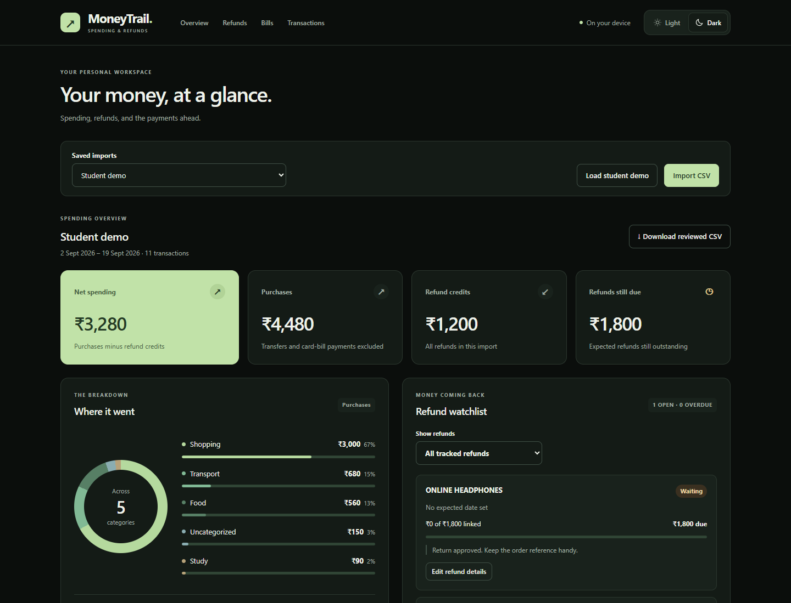

# MoneyTrail

I use UPI and a credit card, and it can be hard to see where small spends went or whether a refund actually came back. MoneyTrail is a project I'm building around those two questions.



Black and green in dark mode, with a separate light palette. [View the light theme](docs/preview-light.png). The previews use the student demo after a few review actions; all data shown is synthetic.

## Hosted app

[Open MoneyTrail](https://moneytrail.syrupypony1025.chatgpt.site) on a phone or laptop. The site uses ChatGPT sign-in; each signed-in account's imports, edits, and bill schedules are kept separately in hosted storage so they are available across devices. The hosted source and deployment notes are in [`site/`](site/README.md).

The hosted database starts separately from the local `data/moneytrail.db`. To move a reviewed import, download its reviewed CSV from the local app and import that CSV into the hosted app. The local database remains untouched; bills can be re-entered. MoneyTrail does not connect to a bank or make payments.

## Run the web app

Requires Python 3.10 or newer. There are no extra packages to install.

```powershell
python -m src.app
```

Open [MoneyTrail](http://127.0.0.1:8001) in your browser. Keep the terminal running; Ctrl+C stops the server. If the port is busy, run `python -m src.app --port 8002` and use the address it prints. Opening the HTML file directly or using a plain static server will not run the app.

## What works

- Switch between light and dark mode in the header. The app starts with your device's theme and remembers your choice in this browser.
- Install MoneyTrail from a supported browser when the **Install app** button appears.
- Import a transaction CSV and switch between saved imports.
- Import a bank statement CSV by mapping its date, description, and amount columns, with a preview before saving.
- See purchases, refund credits, net spending, and refunds still due.
- See category amounts and percentages with a spending breakdown chart.
- Compare equal-length periods to see category changes, purchase counts, average costs, and the transactions behind each change.
- Search transactions, clear active filters in one click, and filter by colored transaction type. Large imports show 25 rows per page; phone layouts keep amounts and actions visible without sideways scrolling.
- Accept a category suggestion or enter your own category.
- Correct a transaction type when a statement description was classified incorrectly; transfers stay out of spending totals.
- Mark a purchase as expecting a full or partial refund.
- Set an expected refund date, keep a short note, and filter the watchlist to overdue refunds.
- Add one-time bills or recurring subscriptions, see what's due over the next seven days, and flag past-due payments.
- Review suggested refund links, choose a purchase manually, or undo a link.
- Download a CSV containing your reviewed categories and refund links.

Edits are saved in `data/moneytrail.db`, a local SQLite database excluded from Git. Reloading the page or restarting the server keeps your work. The original CSV is not changed. Reimporting the same original transaction data reopens its saved workspace, including edits; a different import gets a separate workspace. Links stay within one import, so include the purchase and its later refund in the same CSV.

## What changed in my spending?

Below the refund panels, choose an earlier and a later period in **What changed in my spending?** You can compare two saved imports or two periods from one import. Dates initially cover 28 days ending at the import's latest transaction. Adjust them to your statement coverage, then click **Compare spending**. **Use preceding period** sets the earlier dates to the same number of days immediately before the later period, keeping your selected imports.

Periods must have equal numbers of calendar days and cannot overlap. For example, compare September 1–28 with August 1–28. Use statements covering the same accounts. Transaction dates alone cannot prove a statement is complete; the app flags empty windows, windows extending beyond recorded dates, and different account names.

Categories appear in order of the largest absolute change. Each shows the earlier and later totals, purchase count, average purchase cost, and a plain explanation. Expand either period to inspect the purchases, sorted by amount. Categories load eight at a time and expanded transaction lists show 25 at a time. Refund credits are shown separately and affect net spending on the date received; expected refunds and transfers do not count as purchases. Comparisons read saved category edits and never merge or modify imports.

To try it with synthetic data, import `data/raw/spending_comparison.csv`. Select that import on both sides, set **August 1–28, 2026** and **September 1–28, 2026**, then compare. Food rises from INR 400 across two purchases to INR 1,200 across four; a single INR 2,000 headphones purchase appears under Shopping. Purchases rise INR 2,300, while a separate INR 500 refund makes the net increase INR 1,800.

## Bills and subscriptions

Use **Add a bill** to enter an amount, next payment date, and whether the bill is one-time, weekly, monthly, every three months, or yearly. Bills are saved locally and appear even when you have not imported a CSV. They are shared across saved imports, so changing statements does not hide your bill deadlines. You can edit or pause a bill, filter to the next seven days or past-due bills, and see the amount due from today through six days ahead. Past-due amounts are shown separately. Dates use your browser's local calendar day.

Choose **Autopay** only as a label for a payment you expect the provider to take automatically. MoneyTrail does not set up, cancel, verify, or make payments. When an autopay date passes, check your bank or provider before marking it paid. **Mark paid** advances a recurring bill by one billing period; a one-time bill moves to the paid list. **Undo last payment** reverses the latest mark. Pausing a bill keeps its next date, so check or edit that date when you resume. Imported spending totals remain based on your CSV and are not changed by bill tracking.

The monthly recurring average combines active weekly, monthly, quarterly, and yearly amounts as 52/12, 1, 1/3, and 1/12 months respectively. One-time and paused bills are excluded. It is an average for planning; actual payment dates and amounts are shown in the bill list.

## Try the demo

Click **Load student demo**. All of its transactions are synthetic.

1. It starts with INR 4,480 in purchases, INR 1,200 in refund credits, and INR 3,280 in net spending. A card-bill payment is excluded from spending.
2. The bookstore purchase expects INR 1,200 back, with INR 900 already linked. Confirm the suggested INR 300 credit: the bookstore status changes to **Received**, and total refunds still due drops from INR 2,100 to INR 1,800.
3. Net spending stays INR 3,280 because that credit was already in the statement. Confirming its link only changes the watchlist.
4. Click **Use Food** for the Swiggy purchase. Its INR 320 moves from Uncategorized to Food.
5. Use **Edit** to enter another category or expected refund amount. Refresh to check the saved result, then download the reviewed CSV.
6. Choose **Edit refund details** on a watchlist item. Add the date the merchant gave you and an optional note, then save. Use **Overdue only** to see refunds whose expected dates have passed and still have money due.

The demo is saved too. Loading it again reopens your edited copy.

## CSV format

You can also import a bank export without rewriting its headers. Choose **Import CSV** and select the file. If it is not already in MoneyTrail's format, the column mapper opens. Select the date format, the date and description columns, either separate debit/credit columns or one signed amount column, and an account name. Click **Preview rows** to validate the full file and inspect the first eight converted transactions, then **Import statement**. Try `data/raw/bank_statement_example.csv` with the suggested mapping. The account name is a label in MoneyTrail, not a bank connection.

The mapper treats debits as purchases unless the description clearly says card-bill payment or self-transfer. A positive credit is a refund only when its description says refund, reversal, cashback, or chargeback; other credits are transfers and do not reduce spending. Check the preview and your bank export before importing. After import, use **Edit** on any transaction to correct its type. Changing type clears category or refund details that no longer apply; unlink any other refunds pointing to a purchase before changing that purchase into a transfer. Date order must be selected explicitly for ambiguous dates. This first version supports UTF-8 comma-separated files with a header row and up to 10,000 rows; it does not read PDF statements or connect to a bank.

MoneyTrail's original CSV format still works directly. Use UTF-8 text, dates like `2026-09-05`, and these columns:

```csv
id,date,description,amount,account,kind,category,refund_expected,refund_for
p1,2026-09-05,BOOKSTORE ONLINE,-1200.00,Card,purchase,Shopping,1200.00,
r1,2026-09-12,BOOKSTORE PARTIAL REFUND,900.00,Card,refund,,,p1
r2,2026-09-15,BOOKSTORE FINAL REFUND,300.00,Card,refund,,,
```

Each transaction needs a unique ID within its file. Purchases have negative amounts, refunds have positive amounts, and `kind` is `purchase`, `refund`, or `transfer`. Money values support up to two decimal places and must be below one billion INR. The web importer accepts up to 2 MB and 10,000 rows. It validates the whole file before saving.

Leave `category` blank to review it later. Leave `refund_expected` blank or use 0 if you are not tracking a refund. On a refund row, `refund_for` is the original purchase's ID; leave it blank until you confirm the link.

Two optional columns, `refund_due` and `refund_note`, store follow-up details on purchases. `refund_due` uses YYYY-MM-DD and cannot be before the purchase date. `refund_note` allows up to 200 characters. Older CSVs work without either column; reviewed CSV downloads include both. Saved databases are upgraded automatically, preserving existing imports and edits.

Expected dates are entered by you, based on what the merchant told you. A refund becomes overdue the day after that date, using your browser's local calendar date, while money is still due. A date of today shows **Due today**. Purchases without a date, fully received refunds, and purchases with no expected refund amount are never marked overdue. Linking the final refund removes an item from the overdue filter; its date and note remain saved. The filter only changes the watchlist, so overview totals stay the same. This feature does not send notifications.

Bank exports may need their columns converted to this format first.

## Calculation rules

Purchases count as spending. Transfers such as card-bill payments do not. Actual refund credits reduce net spending whether or not they have been linked. An expected refund never reduces spending on its own.

The watchlist uses only confirmed links. It supports several credits for one purchase, and partial returns where the expected refund is smaller than the purchase price. If linked credits exceed the expected refund, the full received amount is shown and the amount still due stays at zero.

Category suggestions use a small keyword list. Ambiguous or unknown descriptions remain Uncategorized until reviewed. Refund suggestions need a shared description word, a refund date on or after the purchase, and an amount no larger than what is still due. These clues can miss a real match or suggest the wrong purchase; the user makes the final choice.

## Project structure

```text
money/
├── data/
│   ├── processed/        # Local exports and generated data (Git-ignored)
│   └── raw/              # Synthetic CSV examples
├── docs/                 # README preview images
├── src/
│   ├── static/           # Browser JavaScript and CSS
│   ├── templates/        # HTML page
│   ├── app.py            # Local server and SQLite storage
│   ├── bills.py          # Bill scheduling rules
│   └── main.py           # CSV parsing and spending calculations
├── tests/                # Python and browser-logic checks
├── .gitignore
└── README.md
```

## How the code fits together

| File | Job |
| --- | --- |
| `src/main.py` | Parse CSVs and calculate totals, categories, watchlists, and suggestions |
| `src/statement_import.py`, `src/static/statement-import.js` | Map bank CSV columns and preview converted transactions |
| `src/app.py` | Serve the local API and save imports and edits in SQLite |
| `src/comparison.py`, `src/static/comparison.js` | Compare spending periods and show the supporting transactions |
| `src/static/app.js` | Load API results and handle browser actions |
| `src/bills.py`, `src/static/bills.js` | Save bill schedules, handle recurrence, and render payment deadlines |
| `src/static/theme.js` | Apply and remember light or dark mode before the page paints |
| `src/templates/index.html`, `src/static/style.css` | Page structure and appearance |
| `tests/` | Calculation, storage, API, recurrence, and browser logic checks |

The browser asks Python for the report. Saving an edit validates it, writes it to SQLite, and recalculates the report. Money calculations use Python's `Decimal`. If two tabs edit the same import, a stale save is rejected so it cannot quietly overwrite a newer edit.

Refund suggestions index merchant words once and compare only purchases that share a word. The browser caches sorted transactions and searchable text for each loaded report, then renders one page at a time. These are performance changes; refund matching rules and full-import totals are the same.

## Terminal version

The original terminal report still works:

```powershell
python -m src.main
python -m src.main data/raw/unlinked_refund.csv
python -m src.main data/raw/uncategorized.csv
python -m src.main "D:\statements\october transactions.csv"
python -m src.main --help
```

This command reads a CSV without changing it. It does not read edits saved in the web app unless you download the reviewed CSV and pass that file.

## Checks

```powershell
python -m unittest discover -s tests -v
```

Tests use temporary databases and synthetic data. They cover partial refunds, duplicate imports, persistence, invalid updates, stale edits, CSV export, and the HTTP API.

If Node.js is available, run `node tests/test_frontend.cjs` for theme persistence, refund dates, edit forms, pagination, search, and control states during saves. These use a small simulated DOM; they do not replace a visual browser check. The app itself still only requires Python.

Run `node tests/test_bills_frontend.cjs` to check the bill filters, autopay label, and edit actions in a simulated DOM.

Run `node tests/test_comparison_frontend.cjs` for comparison date controls, evidence lists, errors, and stale response handling in a simulated DOM.

## Current scope

The Python version is a local app bound to 127.0.0.1. The hosted website is publicly reachable, uses ChatGPT sign-in for account data, and stores data separately. Neither version has a bank connection or sends notifications. Imports are separate workspaces rather than a combined account history, and bill dates are entered manually.
